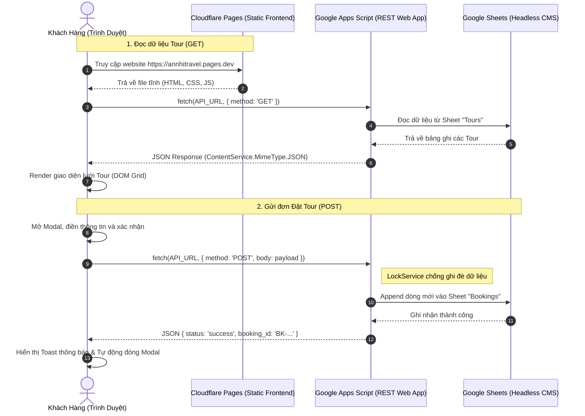

# Annhi Travel - Hệ Thống Website Tour Du Lịch Headless CMS

> **Kiến trúc:** Static Website (Vanilla HTML5 / CSS3 / ES6+ JavaScript)  
> **Headless CMS & CSDL:** Google Sheets  
> **Backend Engine:** Google Apps Script Web App (RESTful API)  
> **Hạ tầng triển khai:** Cloudflare Pages (Edge CDN toàn cầu)

---

## 1. Sơ Đồ Kiến Trúc & Luồng Dữ Liệu



---

## 2. Cấu Trúc Cơ Sở Dữ Liệu (Google Sheets)

Hệ thống sử dụng Google Spreadsheet gồm 2 trang tính (Sheets) chính:

### Sheet 1: `Tours` (Quản lý danh sách tour hiển thị)
| Cột | Tên Cột | Kiểu Dữ Liệu | Ví Dụ | Giải Thích |
|:---:|:---|:---|:---|:---|
| A | `id` | String | `tour-01` | Mã định danh duy nhất của tour |
| B | `tour_name` | String | `Khám Phá Đảo Ngọc Phú Quốc` | Tên tiêu đề tour hiển thị |
| C | `destination` | String | `Phú Quốc, Kiên Giang` | Địa danh điểm đến |
| D | `price` | Number | `4290000` | Giá tour tính theo VNĐ (số nguyên) |
| E | `duration` | String | `3 Ngày 2 Đêm` | Thời lượng hành trình |
| F | `image_url` | String (URL) | `https://images.unsplash.com/...` | Link ảnh đại diện độ nét cao |
| G | `description` | String | `Trải nghiệm cáp treo vượt biển...` | Mô tả tóm tắt điểm nổi bật |

### Sheet 2: `Bookings` (Lưu thông tin khách hàng đặt tour)
| Cột | Tên Cột | Kiểu Dữ Liệu | Ví Dụ | Giải Thích |
|:---:|:---|:---|:---|:---|
| A | `booking_id` | String | `BK-20261105-144000-852` | Mã đơn sinh tự động độc nhất |
| B | `tour_id` | String | `tour-01` | Mã tour khách hàng đăng ký |
| C | `customer_name` | String | `Nguyễn Văn An` | Họ và tên khách hàng |
| D | `phone` | String | `0912345678` | Số điện thoại liên hệ |
| E | `email` | String | `nguyenvana@gmail.com` | Email nhận xác nhận đặt chỗ |
| F | `date_booked` | Datetime | `2026-11-05 14:40:00` | Thời điểm ghi nhận (GMT+7) |

---

## 3. Triển Khai Backend - Google Apps Script (`Code.gs`)

### Bước 1: Khởi tạo Google Sheet & Mở Trình chỉnh sửa
1. Truy cập [Google Sheets](https://sheets.new) để tạo trang tính mới, đặt tên: `Annhi Travel CMS`.
2. Trên thanh menu, chọn **Tiện ích mở rộng (Extensions)** > **Apps Script**.

### Bước 2: Dán mã nguồn và Khởi tạo CSDL tự động
1. Xóa toàn bộ nội dung mặc định trong tệp `Code.gs` và dán mã nguồn từ tệp [`google-apps-script/Code.gs`](file:///c:/Users/Admin/Documents/Annhitravel/google-apps-script/Code.gs).
2. Tại thanh công cụ Apps Script, chọn hàm **`setupDatabase`** và bấm **Run (Chạy)**.
3. Cho phép cấp quyền (Authorization) nếu Google yêu cầu.  
   *(Hàm này sẽ tự động khởi tạo 2 sheet `Tours` và `Bookings`, định dạng tiêu đề chuyên nghiệp và thêm sẵn 6 tour du lịch mẫu tuyệt đẹp).*

### Bước 3: Triển khai ứng dụng Web (Deploy Web App)
1. Nhấn nút **Deploy (Triển khai)** ở góc trên bên phải > Chọn **New deployment (Triển khai mới)**.
2. Chọn loại: biểu tượng bánh răng ⚙️ > **Web app**.
3. Điền cấu hình chính xác:
   - **Description**: `Annhi Travel REST API v1`
   - **Execute as (Thực thi dưới tên)**: **Me (Tôi - email của bạn)**
   - **Who has access (Ai có quyền truy cập)**: **Anyone (Bất kỳ ai)** *(Bắt buộc để website khách có thể gọi API)*
4. Nhấn **Deploy** > Cấp quyền truy cập nếu được yêu cầu.
5. Sao chép chuỗi **Web app URL** (dạng `https://script.google.com/macros/s/AKfycb.../exec`).

### Bước 4: Cập nhật URL vào mã nguồn Frontend
Mở tệp [`script.js`](file:///c:/Users/Admin/Documents/Annhitravel/script.js) và dán URL vừa sao chép vào:
```javascript
const CONFIG = {
  API_URL: 'https://script.google.com/macros/s/AKfycb.../exec', // Thay bằng Web App URL thật của bạn
  // ...
};
```

---

## 4. Giải Quyết Vấn Đề Kỹ Thuật Chuyên Sâu

### Giải pháp xử lý CORS & Google Apps Script 302 Redirect
Khi gửi request từ trình duyệt sang domain của Google Apps Script (`script.google.com`):
1. **Nguyên nhân lỗi CORS thường gặp**:  
   Nếu gửi với header `Content-Type: application/json`, trình duyệt bắt buộc gửi một HTTP `OPTIONS` preflight request. Tuy nhiên, Google Apps Script Web App **không hỗ trợ** phương thức `OPTIONS`, dẫn đến trình duyệt chặn đứng request.
2. **Giải pháp tối ưu áp dụng trong `script.js`**:  
   Gửi dữ liệu với header chuẩn CORS-safelisted:  
   `Content-Type: text/plain;charset=utf-8` kết hợp `JSON.stringify(formData)`.  
   - Trình duyệt sẽ gửi trực tiếp `POST` request mà không tạo preflight.  
   - Google Apps Script tiếp nhận chuỗi nguyên bản trong `e.postData.contents`, sau đó giải mã bằng `JSON.parse()`.  
   - Apps Script tự động phản hồi `302 Found` chuyển tiếp tới `script.googleusercontent.com` kèm header `Access-Control-Allow-Origin: *`, cho phép Fetch API đọc dữ liệu mượt mà.

### Cơ chế chống Race Condition (`LockService`)
Trong `doPost(e)` của `Code.gs`, hệ thống sử dụng:
```javascript
const lock = LockService.getScriptLock();
lock.waitLock(10000); // Chờ tối đa 10s để lấy khóa ghi
```
Điều này đảm bảo khi nhiều khách hàng nhấn "Đặt Tour" trong cùng một giây, các dòng dữ liệu trong Sheet `Bookings` được ghi tuần tự, hoàn toàn không bị trùng lặp hoặc xung đột dòng.

---

## 5. Hướng Dẫn Triển Khai Lên Cloudflare Pages

### Phần A: Khởi tạo Git & Đưa mã nguồn lên GitHub

Mở PowerShell / Terminal tại thư mục dự án `c:\Users\Admin\Documents\Annhitravel` và chạy chuỗi lệnh:

```powershell
# 1. Khởi tạo Git repository
git init

# 2. Thêm toàn bộ mã nguồn vào staging
git add .

# 3. Tạo commit đầu tiên
git commit -m "feat: complete headless cms travel tour website with google sheets and cloudflare pages"

# 4. Đổi nhánh chính sang 'main'
git branch -M main

# 5. Liên kết tới remote repo GitHub của bạn (thay username và repo của bạn)
git remote add origin https://github.com/<your-username>/annhitravel.git

# 6. Đẩy mã nguồn lên GitHub
git push -u origin main
```

---

### Phần B: Cấu hình Cloudflare Pages

1. Đăng nhập vào bảng điều khiển [Cloudflare Dashboard](https://dash.cloudflare.com/).
2. Điều hướng tới menu bên trái: **Workers & Pages** > Chọn thẻ **Pages**.
3. Nhấp vào nút **Connect to Git** (Kết nối với Git) > Chọn tài khoản GitHub và chọn repository `annhitravel`.
4. Tại bước **Set up builds and deployments**, cấu hình như sau:
   - **Project name**: `annhitravel` (hoặc tên tùy chọn)
   - **Production branch**: `main`
   - **Framework preset**: Chọn **None** (Do dự án là thuần HTML/CSS/JS tĩnh)
   - **Build command**: *Để trống* (Không cần build tool)
   - **Build output directory**: Để dấu chấm `.` hoặc `/` (Gốc thư mục chứa `index.html`)
5. Nhấp vào nút **Save and Deploy**.
6. Cloudflare Pages sẽ triển khai website trong vòng chưa đầy **15 giây** với địa chỉ truy cập toàn cầu miễn phí dạng:  
   👉 `https://annhitravel.pages.dev`

> **Ưu điểm khi triển khai Cloudflare Pages:**
> - Băng thông không giới hạn và hoàn toàn miễn phí.
> - Chứng chỉ SSL/TLS (HTTPS) được kích hoạt tự động.
> - Hỗ trợ liên kết Tên miền riêng (Custom Domain) cực kỳ dễ dàng.
> - Cơ chế CI/CD tự động: Mỗi khi bạn `git push` thay đổi mới lên GitHub, Cloudflare Pages sẽ tự động cập nhật website ngay lập tức.

